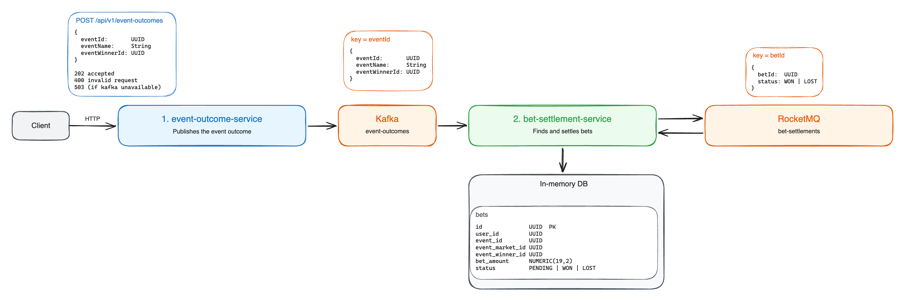

# Bet Settlement

## Prerequisites

- Docker and Docker Compose
- Java 25 and Gradle, only to run the tests (the Gradle wrapper is included)

## Technical Stack

- Java 25
- Gradle
- Spring Boot 4.2.0
- Spring Data JDBC
- H2 (in-memory)
- Flyway
- Kafka
- RocketMQ
- OpenAPI

## Design

Two services:

- **event-outcome-service**: publishes event outcomes to Kafka
- **bet-settlement-service**: finds the bets of the event, sends them to RocketMQ, consumes RocketMQ and settles the bets



### Justification

Outcomes can come from different sources, so publishing them is separate from settling the bets.

## Getting Started

```bash
docker compose up --build
```

## API Documentation

### Swagger UI

- event-outcome-service: http://localhost:8080/api/v1/swagger-ui.html
- bet-settlement-service: http://localhost:8082/api/v1/swagger-ui.html

### cURL Example

Demo bets are added on startup. Publish an event outcome:

```bash
curl -i -X POST http://localhost:8080/api/v1/event-outcomes \
  -H 'Content-Type: application/json' \
  -d '{
    "eventId": "a1f0c3d2-0000-4000-8000-000000000001",
    "eventName": "Real Madrid vs Barcelona",
    "eventWinnerId": "b2e1d4c3-0000-4000-8000-000000000001"
  }'
```

Check that its bets are settled (the first settlement takes about 30 seconds, while RocketMQ creates its topic):

```bash
curl 'http://localhost:8082/api/v1/bets?eventId=a1f0c3d2-0000-4000-8000-000000000001'
```

## Code Quality

```bash
./gradlew check
```

### Code Coverage

JaCoCo requires at least 80% coverage. Reports are generated in `build/reports/jacoco/test/html/` of each service.

### Code Formatting

Spotless checks google-java-format. To apply it:

```bash
./gradlew spotlessApply
```
